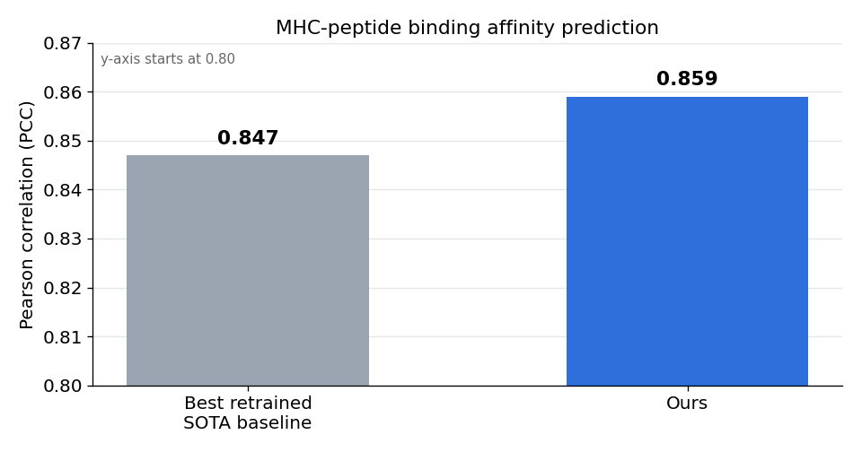
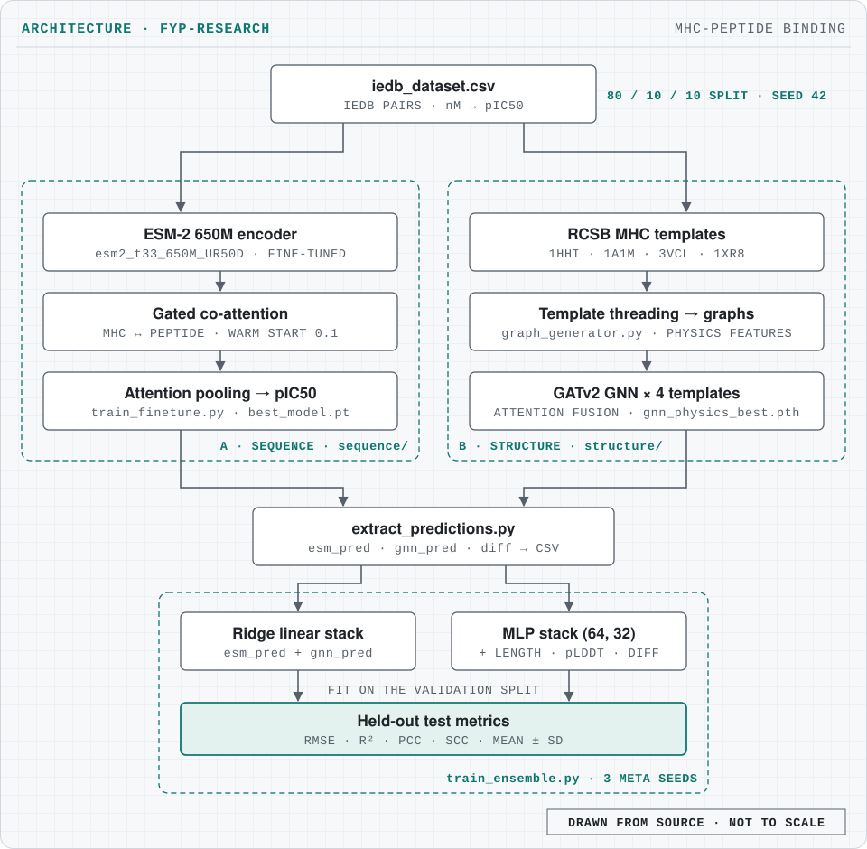
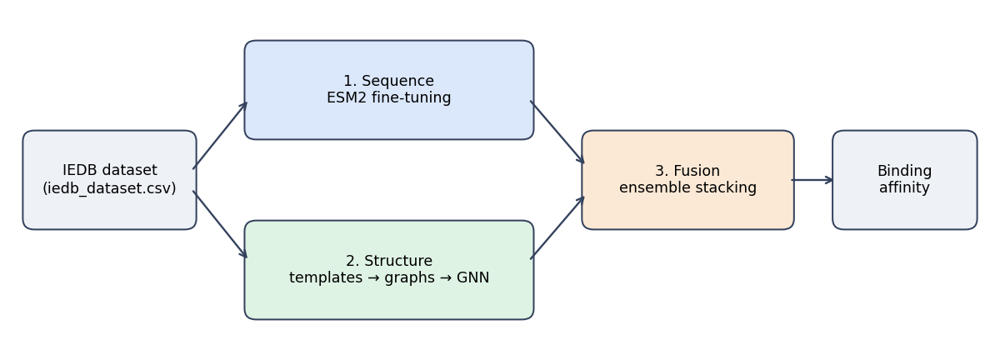

# ESM2 Multimodal Pipeline

MHC-peptide binding affinity prediction that combines LoRA fine-tuned ESM-2 650M sequence embeddings with AlphaFold-derived structure, reaching PCC 0.859 against 0.847 for the best retrained state-of-the-art baseline; submitted to ICLR 2027.

[](https://www.python.org/)
[](https://pytorch.org/)
[](https://github.com/facebookresearch/esm)
[](#)



## What it does

The pipeline predicts how strongly a peptide binds to an MHC molecule (as pIC50) from two views of the same pair: the amino-acid sequences and a 3D structure graph. Each view trains its own model, and a small stacking model combines their predictions.

This repository is organized for readers who want to reproduce a three-stage MHC-peptide binding workflow:

1. Sequence model training in [sequence](sequence)
2. Structure graph generation and GNN training in [structure](structure)
3. Fusion/ensemble stacking at repository root

## Architecture

<picture>
  <source media="(prefers-color-scheme: dark)" srcset="docs/architecture-dark.svg">
  
</picture>

- **Data.** [iedb_dataset.csv](iedb_dataset.csv) holds 85,628 IEDB MHC-peptide pairs with affinities in nM, converted to pIC50. Both branches use the same 80/10/10 train/validation/test split with seed 42.
- **Sequence branch** ([sequence/train_finetune.py](sequence/train_finetune.py)). ESM-2 650M (`facebook/esm2_t33_650M_UR50D`) encodes the MHC and the peptide; a gated co-attention layer, warm-started at 0.1, lets each attend to the other; attention pooling feeds a regression head.
- **Structure branch** ([structure/](structure)). Sequences are threaded onto four RCSB MHC templates (1HHI, 1A1M, 3VCL, 1XR8) to build graphs with physics features; a GATv2 network embeds each template graph and multi-head attention fuses the four.
- **Fusion.** [extract_predictions.py](extract_predictions.py) runs both trained models and writes `ensemble_meta_data.csv`; [train_ensemble.py](train_ensemble.py) fits a Ridge stack and an MLP stack on the validation split only and reports RMSE, R², PCC and SCC on the held-out test split, as mean ± SD over three meta seeds.



## Tech stack

| Area | Tools |
|---|---|
| Language | Python 3.8.10 |
| Sequence model | PyTorch 2.4.1, Hugging Face Transformers 4.46.3, ESM-2 650M |
| Structure model | PyTorch Geometric 2.6.1 (GATv2), Biopython 1.83 |
| Stacking and metrics | scikit-learn 1.3.2 (Ridge, MLPRegressor), SciPy |
| Configuration | YAML ([sequence/config.yaml](sequence/config.yaml)), Pydantic |

Exact versions are pinned in [requirements.txt](requirements.txt).

## Getting started

### Environment setup

Use one Python 3.8.10 virtual environment for the entire pipeline. Create it from the root so the same environment is used for sequence, structure, and ensemble steps.

```bash
python3.8 -m venv .venv
source .venv/bin/activate
python --version
pip install --upgrade pip
pip install -r requirements.txt
```

If `python3.8` is not the exact interpreter on your machine, use the full path to your Python 3.8.10 binary when creating the venv. The PyTorch Geometric wheels in `requirements.txt` are the CUDA 12.1 builds for PyTorch 2.4.1.

No environment variables are required. The sequence scripts honour an optional `PYTHON_BIN` to pick the interpreter.

### Data availability

Large generated assets are not versioned in this repository.

* The main dataset file used by the pipeline is [iedb_dataset.csv](iedb_dataset.csv).
* Structure-derived artifacts (for example generated graphs and intermediate structure outputs under [structure/data](structure/data)) are stored on BioNet internal storage for lab use.
* If you are an external reviewer and need those assets, please request access from the repository owner.

### End-to-end run order

Run from repository root unless otherwise noted.

1. Sequence training/evaluation

```bash
bash sequence/train.sh
bash sequence/test.sh
```

2. Structure pipeline

```bash
cd structure
python download_templates.py
python graph_generator.py
python train_gnn_model.py
# optional watchdog wrapper:
# bash train_gnn_model.sh
cd ..
```

The structure step runs in the same Python environment as the sequence step; it does not require a separate conda environment in the current repo layout. See [structure/README.md](structure/README.md) for details.

3. Ensemble/fusion

```bash
bash extract_and_ensemble.sh
```

This executes [extract_predictions.py](extract_predictions.py) followed by [train_ensemble.py](train_ensemble.py). Legacy wrapper [run_full_pipeline.sh](run_full_pipeline.sh) delegates to the same flow.

### Reproducing the headline result

The headline figure is a test-set Pearson correlation (PCC) of 0.859, against 0.847 for the best retrained state-of-the-art baseline.

What is in this repository:

* **The script that computes PCC:** [train_ensemble.py](train_ensemble.py). It prints RMSE, R², PCC and SCC for four predictors (ESM only, GNN only, linear stack, MLP stack) into `ensemble_results_report.txt` and writes `ensemble_seed_results.csv` and `ensemble_mean_sd_summary.csv`. Defaults: `--split-seed 42`, `--meta-seeds 42,123,999`.
* **Its input:** `ensemble_meta_data.csv`, produced by [extract_predictions.py](extract_predictions.py) from the two trained checkpoints, `checkpoints/checkpoints_esm2_warmstart/best_model.pt` (sequence) and `structure/checkpoints/gnn_physics_best.pth` (structure).
* **The configs behind those checkpoints:** [sequence/config.yaml](sequence/config.yaml) for the sequence model and the `CONFIG` block at the top of [structure/train_gnn_model.py](structure/train_gnn_model.py) for the GNN. [config_multimodal.yaml](config_multimodal.yaml) is a reference config that the scripts do not read.
* **The full chain:** `bash sequence/train.sh`, then the structure steps above, then `bash extract_and_ensemble.sh`.

What is not in this repository:

* No trained checkpoints and no saved result file: checkpoints, reports and ensemble CSVs are git-ignored, so the 0.859 figure is not recorded in a committed file.
* Structure assets (generated graphs, ColabFold outputs under the ignored `localcolabfold/` and `structure/data/generated_pdbs`) are on lab storage, as noted above. `extract_predictions.py` reads an optional `mean_plddt` column that `iedb_dataset.csv` does not contain, so it falls back to 0.
* The code here fine-tunes ESM-2 fully (`freeze_esm: false`) rather than through LoRA/PEFT, builds structure graphs by template threading, and splits at random with seed 42. The LoRA setup, the ColabFold structure extension and the homology-based split are not part of the committed code.

### Notes for reproducibility

* Primary sequence config: [sequence/config.yaml](sequence/config.yaml)
* Integration reference config: [config_multimodal.yaml](config_multimodal.yaml)
* Root entry scripts are path-safe and can be called from any working directory.
* The shared environment is a root [venv](https://docs.python.org/3/library/venv.html) created from Python 3.8.10 and populated from [requirements.txt](requirements.txt).

### Generated artifacts and git ignore policy

Generated files are intentionally excluded from version control via [.gitignore](.gitignore), including:

* model checkpoints (`*.pt`, `*.pth`, `*.pkl`)
* logs and run reports
* ensemble outputs (`ensemble_meta_data.csv`, `ensemble_seed_results.csv`, `ensemble_mean_sd_summary.csv`, `final_ensemble_test_results.csv`)
* visualization outputs under `training_visualizations/figures` and `training_visualizations/reports`
* temporary structure chunks under `structure/tmp`

## Project structure

```text
.
├── iedb_dataset.csv            # IEDB MHC-peptide pairs (input)
├── sequence/                   # ESM-2 fine-tuning: train_finetune.py, config.yaml, train.sh, test.sh
├── structure/                  # templates, graph_generator.py, train_gnn_model.py
├── extract_predictions.py      # runs both models, writes ensemble_meta_data.csv
├── train_ensemble.py           # Ridge and MLP stacking, test metrics
├── extract_and_ensemble.sh     # fusion entry point
├── run_full_pipeline.sh        # legacy wrapper for the fusion step
├── training_visualizations/    # plotting scripts
└── docs/                       # figures used in this README
```

## Results

The chart at the top of this page compares test-set PCC: 0.859 for this pipeline against 0.847 for the best retrained state-of-the-art baseline. The work is submitted to ICLR 2027.

### Visualization scripts

Scripts:

* [training_visualizations/scripts/generate_requested_visualizations.py](training_visualizations/scripts/generate_requested_visualizations.py)
* [training_visualizations/scripts/visualize_training_logs.py](training_visualizations/scripts/visualize_training_logs.py)
* [training_visualizations/scripts/auc_calc.py](training_visualizations/scripts/auc_calc.py)

Run from repository root:

```bash
python training_visualizations/scripts/generate_requested_visualizations.py
python training_visualizations/scripts/visualize_training_logs.py
python training_visualizations/scripts/auc_calc.py
```

Outputs go to `training_visualizations/figures` and `training_visualizations/reports`.
